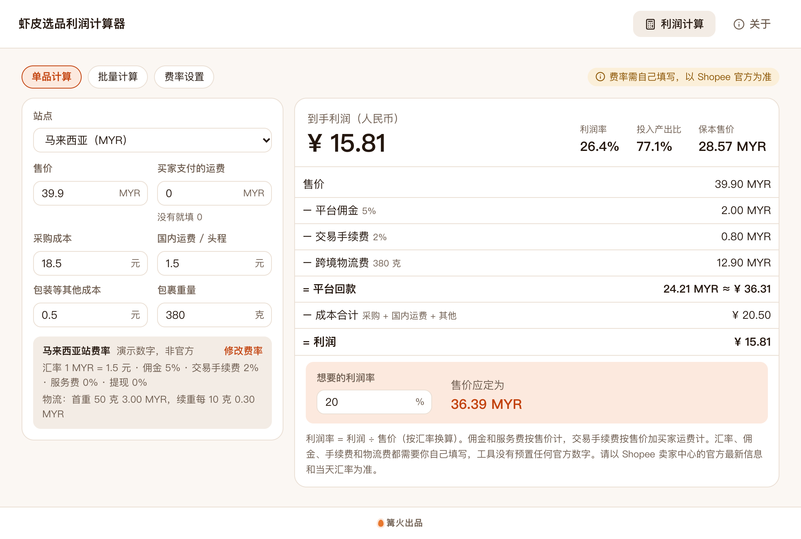

# 虾皮选品利润计算器

> 篝火出品 · 收录于篝火 App 应用区

商品页一键算毛利、佣金和运费



## 下载

到 [Releases](https://github.com/campfire-code/shopee-profit-calculator/releases/latest) 下载对应安装包：

| 电脑 | 文件 |
|---|---|
| Windows 10 / 11 | `shopee-profit-calculator_版本号_windows-x64-setup.exe` |
| Mac（Apple 芯片） | `shopee-profit-calculator_版本号_mac-arm64.dmg` |
| Mac（Intel 芯片） | `shopee-profit-calculator_版本号_mac-x64.dmg` |

第一次打开：
- **Windows**：如果弹出「Windows 已保护你的电脑」，点「更多信息」→「仍要运行」。
- **Mac**：如果提示「无法验证开发者」，打开「系统设置 → 隐私与安全性」，在下方点「仍要打开」。

## 怎么用

**重要：本工具不预置任何 Shopee 汇率、佣金、手续费和物流费**，这些数字各站点、各类目、各卖家计划都不同且会调整，工具没有核实过任何一个。请先到 Shopee 卖家中心查好官方最新数字，**一切以平台为准**。

1. 打开「费率设置」页签，给你要做的站点填：汇率（1 当地币 = 多少元）、佣金 %、交易手续费 %、服务费 %、提现手续费 %、物流的首重/首重费/续重单位/续重费。填一次即可，自动保存在这台电脑上，不会上传。
2. 「单品计算」：选站点，填售价、买家支付的运费、采购成本、国内运费、其他成本和包裹重量，右侧实时显示佣金、手续费、物流费、平台回款、利润、利润率、投入产出比和保本售价；亏损时有红色提醒。底部填「想要的利润率」，会反推售价应定为多少。
3. 「批量计算」：把 Excel（.xlsx）或 CSV 拖进来（或点击选择），每行一个商品，至少要有「售价」「采购成本」「重量(克)」三列，站点列可写中文名、站点代码或币种，留空则按当前选择的站点。可先点「下载批量模板」。算完点「导出结果 Excel」，导出的文件含逐项明细和所用费率两个表。不支持旧版 .xls。
4. 计算口径：佣金、服务费按售价计；交易手续费按「售价 + 买家支付运费」计；提现手续费按平台结算金额计；物流费 = 首重费 + 超出首重部分按续重单位向上取整 × 续重费；利润率 = 利润 ÷ 售价（换算成元）。与你的真实账单口径不同时，可以把差额折算进对应费率。

限制：不联网，不读取商品页，不自动获取汇率和平台费率；物流费只支持「首重 + 续重」这一种计价方式。

## 验收用例

以下演示数字只用来验收，不是 Shopee 官方费率。

1. 打开「费率设置」，按下表填三个站点，其余站点保持 0（页面显示「未填写」）：

| 站点 | 汇率 | 佣金 % | 交易手续费 % | 服务费 / 提现 % | 首重 克 | 首重费 | 续重单位 克 | 续重费 |
|---|---|---|---|---|---|---|---|---|
| 新加坡 | 5 | 5 | 2 | 0 / 0 | 50 | 1.5 | 10 | 0.2 |
| 马来西亚 | 1.5 | 5 | 2 | 0 / 0 | 50 | 3 | 10 | 0.3 |
| 泰国 | 0.2 | 5 | 2 | 0 / 0 | 50 | 25 | 10 | 3 |

2. 单品：选马来西亚，售价 39.9、买家运费 0、采购成本 18.5、国内运费 1.5、其他成本 0.5、重量 380 克。应显示：物流费 12.90 MYR、平台回款 24.21 MYR ≈ ¥ 36.31、利润 ¥ 15.81、利润率 26.4%、投入产出比 77.1%、保本售价 28.57 MYR；利润率填 20% 时售价应定为 36.39 MYR。
3. 把售价改成 20：显示红色亏损提醒，利润为负。
4. 批量：把 `samples/批量计算示例.xlsx` 拖进「批量计算」。应显示：共 6 个、算出 5 个、有问题 1 个（DEMO-005，不认识的站点「火星站」）、亏损 1 个（DEMO-004，利润 −70.88）；DEMO-001 利润 15.81、利润率 26.4%。点「导出结果 Excel」，得到含「利润计算」「所用费率（请以平台为准）」两个表的文件，利润列与界面一致。
5. 费率没填的站点：单品页显示「先填该站的汇率和费率」，批量里对应行提示「还没填汇率」，不会给出错误的利润。

## 自己编译

需要 Node.js 22、pnpm、Rust。

```bash
pnpm install
pnpm test          # 单元测试
pnpm tauri dev     # 开发运行
pnpm tauri build   # 打包
```

界面框架在 `src/kit`（所有 campfire-code 工具共用），本工具的逻辑在 `src/tool`。

## 归属

本工具由**篝火**出品，是篝火 App 应用区收录的开源工具之一，由篝火（GitHub 组织 [campfire-code](https://github.com/campfire-code)）维护与更新。全部工具的目录见 [toolkit-hub](https://github.com/campfire-code/toolkit-hub)。

## 许可证

MIT，版权方为篝火（campfire-code）。
